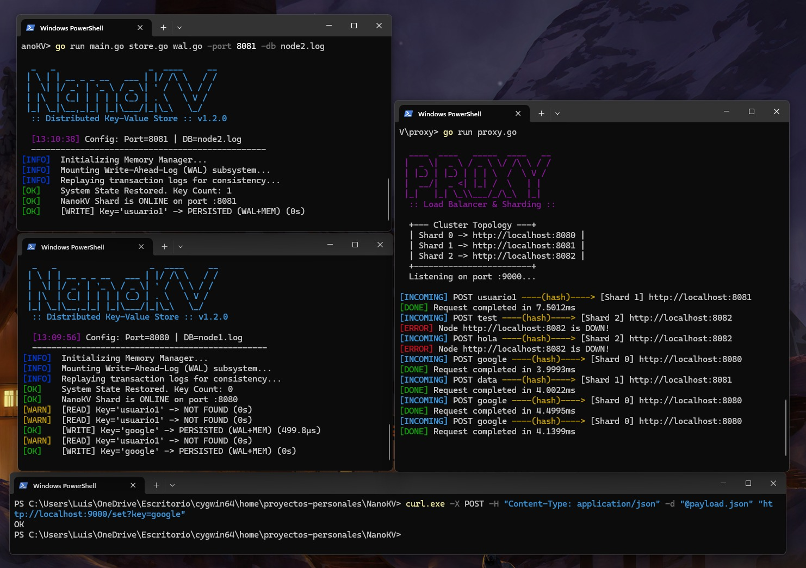
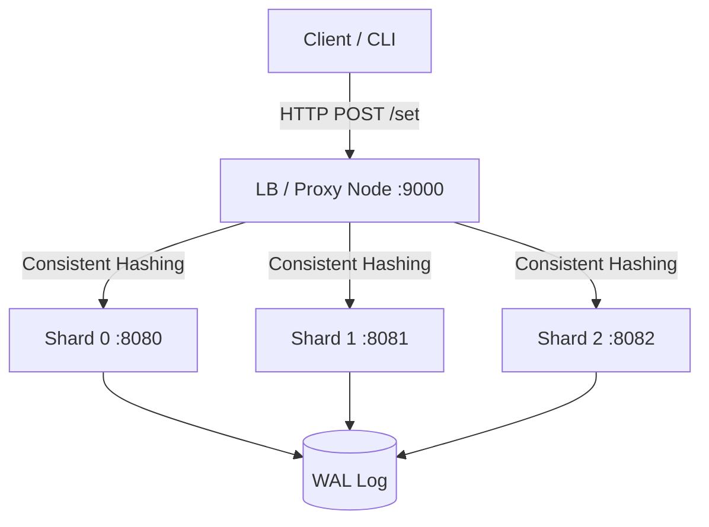

# ⚡ NanoKV: Distributed Key-Value Store

> A high-performance, fault-tolerant distributed key-value database built from scratch in Go. Features **Sharding**, **Write-Ahead Logging (WAL)**, and **Consistent Hashing**.

## 📸 Live System Demo

*Real-time cluster operation showing the Proxy (right) routing requests via Consistent Hashing to specific Shards (left), with persistence logs active.*

---

## 🧠 System Architecture

NanoKV is designed as a distributed system where data is partitioned across multiple nodes to ensure horizontal scalability.

---

## ⚡ Custom Development, Commercial Support & Deployment

Need a custom **distributed backend service**, **low-latency key-value / caching layer**, **scalable REST API (Node.js / TypeScript / Java Spring Boot / Go)**, or **multi-container Docker & Linux server deployment** built for your infrastructure?

I offer fast-turnaround software engineering services and custom proposals on Fiverr:

[-00b22d?style=for-the-badge&logo=fiverr&logoColor=white)](https://www.fiverr.com/thepimen/develop-scalable-rest-apis-with-nodejs-typescript-or-spring-boot)
[-1dbf73?style=for-the-badge&logo=fiverr&logoColor=white)](https://www.fiverr.com/thepimen/dockerize-applications-and-build-microservices-on-linux-servers)

* **24-Hour Express Delivery available** for urgent backend APIs, caching bottlenecks, and Docker/Linux deployments.
* **Direct Engineering Portfolio & Services:** [luislazaro-dev.netlify.app/solutions](https://luislazaro-dev.netlify.app/solutions)

